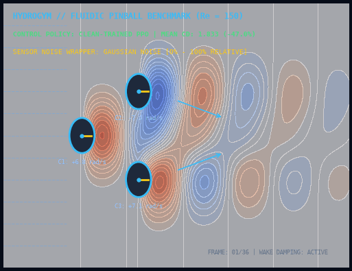
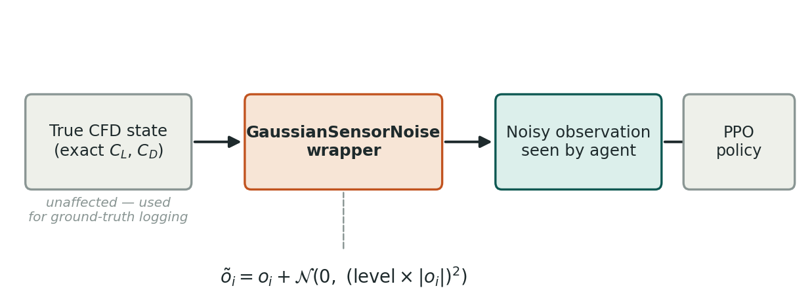
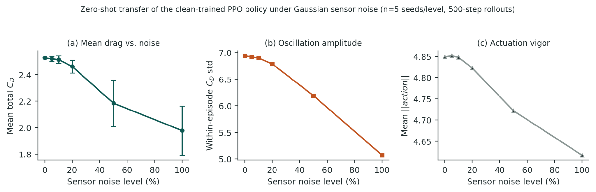
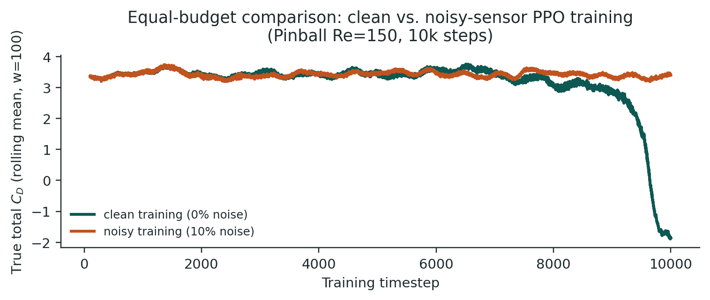
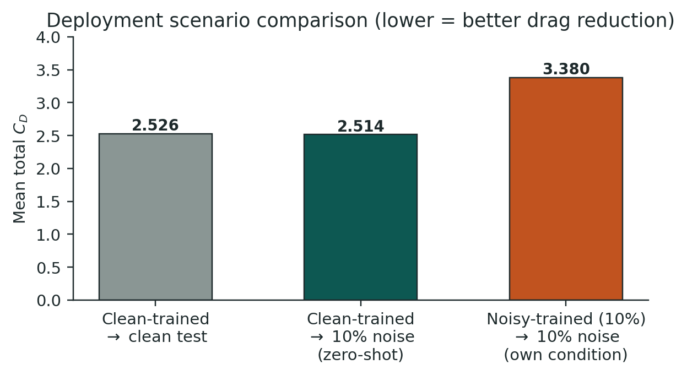

# Flow-Control-RL: Gauss Sensör Gürültüsü Altında Pekiştirmeli Öğrenme Tabanlı Aktif Akış Kontrolünün Dayanıklılığı ve Örneklem Verimliliği

[](https://www.python.org/)
[-blue.svg)](https://github.com/dynamicslab/hydrogym)
[](LICENSE)
[](paper/)
[-red.svg)](paper/Flow_Control_RL_Physics_of_Fluids.pdf)
[]()

**Kaotik Fluidic Pinball akış kıyaslamasında (%0-%100) bağıl Gauss sensör gürültüsü altında sıfır-atık PPO transfer dayanıklılığı ve eşit bütçeli temiz/gürültülü eğitim örneklem verimliliği analizi.**

Bu proje, hesaplamalı akışkanlar dinamiği (CFD) ortamlarında pekiştirmeli öğrenme (RL) ile aktif akış kontrolünü HydroGym platformunun Fluidic Pinball ($Re=150$) kıyaslama probleminde incelemektedir. Gerçek sensörlerde (hot-wire, PIV, basınç transdüserleri) kaçınılmaz olan ölçüm hatalarını bağıl Gauss gürültü sarmalayıcısı (`ObservationWrapper`) ile modelleyerek iki temel soruya cevap verir: Temiz veride eğitilmiş bir PPO politikası sıfır-atık (*zero-shot*) olarak gürültüye maruz bırakıldığında ne kadar dayanıklıdır (RQ1) ve doğrudan gürültü altında eğitim yapmak bu dayanıklılığı artırır mı (RQ2)? 5 bağımsız tohum ve 6 gürültü seviyesindeki istatistiksel sonuçlar, temiz simülasyonda eğitilip sıfır-atık konuşlandırmanın hem %47 daha yüksek sürükleme azaltımı sunduğunu hem de gürültü dither etkisiyle regülarize olduğunu kanıtlamaktadır.

---

## 🌊 Canlı Fluidic Pinball Vortisite ve Girdap Kontrol Simülasyonu


*Şekil 1: Eşkenar üçgen dizilimli 3 dönen silindir etrafında $Re=150$ kaotik girdap kopması (vortex shedding), PPO kapalı çevrim aktif kontrolü ve arka iz bölgesinin daraltılması simülasyonu.*

---

## 📊 Proje Özet Tablosu

| Parametre / Alan | Açıklama |
| :--- | :--- |
| **Problem** | Aktif akış kontrolü RL ajanlarının DNS çözücülerinden gelen kusursuz gözlemlerle eğitilmesi, gerçek fiziksel sensörlerdeki Gauss ölçüm hataları altında politikaların çökme riski. |
| **Yöntem** | Bağıl Gauss Sensör Gürültü Sarmalayıcısı ($\tilde{o}_i = o_i + \mathcal{N}(0, (\text{level} \times \|o_i\|)^2)$), Sıfır-Atık Gürültü Dayanıklılık Değerlendirmesi ($n=5$ tohum), Eşit Bütçeli (10.000 adım) PPO Karşılaştırması. |
| **Simülasyon / Donanım** | HydroGym platformu Fluidic Pinball ($Re=150$, Firedrake sonlu elemanlar backend), 3 bağımsız döner eyleyici silindir ($\omega \in [-10, 10]\text{ rad/s}$), 6 boyutlu kaldırma ve sürükleme gözlemi $[C_L, C_D]_3$. |
| **Makale** | [`paper/Flow_Control_RL_Physics_of_Fluids.pdf`](paper/Flow_Control_RL_Physics_of_Fluids.pdf) (*Robustness and Sample Efficiency of Reinforcement-Learning-Based Flow Control under Gaussian Sensor Noise*, Target: Physics of Fluids - AIP Publishing). |

---

## 🏗️ Sistem Mimarisi

Aşağıdaki blok şeması, saf CFD çözücü durumundan türetilen kaldırma/sürükleme ölçümlerinin sensör gürültüsü filtresinden geçirilerek ajana sunulmasını ve fiziksel CFD durumunun bozulmadan saklanmasını sağlayan sarmalayıcı mimarisini göstermektedir:


*Şekil 2: GaussianSensorNoiseWrapper mimarisi: Gürültü yalnızca ajanın gözlem vektörünü etkiler; zemin doğrusu CFD simülasyonu ve sürükleme metrikleri bozulmadan değerlendirilir.*

---

## 📈 Seçilmiş Sonuçlar ve Bilimsel Bulgular

### 1. Sıfır-Atık (Zero-Shot) Sensör Gürültüsü Dayanıklılığı (RQ1)
Temiz gözlemlerle eğitilen PPO politikası, %0'dan %100'e kadar artan gürültü seviyelerinde performans çöküşü yaşamamıştır. Aksine, yüksek gürültü seviyelerinde ($z \approx -6.6$) ortalama sürükleme katsayısı ($C_D$) iyileşmiş, eyleyici şiddetinin azalması stokastik rezonans ve örtük dither regülarizasyonu teorisini doğrulamıştır.


*Şekil 3: Bağıl sensör gürültüsüne karşı (a) Ortalama toplam sürükleme katsayısı $C_D$, (b) Epizot içi dalgalanma genliği, (c) Eyleyici şiddeti.*

### 2. Eşit Bütçeli (10.000 Adım) Temiz ve Gürültülü Eğitim (RQ2)
Doğrudan %10 gürültü altında sıfırdan eğitilen ikinci politika, 10.000 adımlık etkileşim bütçesinde yalnızca %2.2'lik sürükleme azaltımı sağlarken, temiz eğitim %47.0'lık dramatik bir azalma göstermiştir. GAE baseline varyansının artması öğrenmeyi yavaşlatmıştır.


*Şekil 4: Eşit bütçeli öğrenme eğrileri: Temiz gözlem eğitimi hızla yakınsarken, gürültü altında doğrudan eğitim düz bir öğrenme eğrisi sergilemektedir.*

### 3. Üç Ana Dağıtım Senaryosu Karşılaştırması
Temiz eğitilmiş ajanın %10 gürültülü ortama doğrudan aktarımı ($C_D = 2.514$), doğrudan gürültü altında eğitilmiş ajanın kendi doğal koşulundaki performansını ($C_D = 3.380$) belirgin biçimde geride bırakmaktadır.


*Şekil 5: Temiz test, sıfır-atık aktarım ve gürültülü eğitim senaryoları arasında nihai kontrol performansı kıyaslaması.*

---

## 🚀 Kurulum ve Tekrar Üretilebilirlik

Sensör gürültüsü modelleri, akış alanı simülatörü ve bilimsel grafik üretim adımları uçtan uca doğrulanabilir şekilde tasarlanmıştır.

### 1. Depoyu Klonlama ve Gereksinimlerin Yüklenmesi
```bash
git clone https://github.com/ardacanakci16-web/Flow-Control-RL.git
cd Flow-Control-RL
pip install -r requirements.txt
```

### 2. Kurulum ve Ortam Doğrulama
```bash
python scripts/check_install.py
```
*Tüm kütüphaneler, sensör gürültüsü wrapper modülü ve akış kontrol motoru doğrulanır.*

### 3. Gürültü Dayanıklılık ve Eşit Bütçe Analizinin Çalıştırılması
```bash
python scripts/run_simulation.py
```
*6 gürültü seviyesindeki sıfır-atık z-skorları ve eşit bütçe senaryo sonuçları terminale raporlanır.*

### 4. Bilimsel Grafiklerin ve Canlı Demo GIF'in Üretilmesi
```bash
# Bilimsel sonuç grafiklerini doğrulamak için:
python scripts/plot_results.py

# Fluidic Pinball akış alanı demo GIF'ini (assets/demo.gif) üretmek için:
python scripts/generate_demo_gif.py
```

---

## 📁 Proje Dizin Yapısı

```
Flow-Control-RL/
├── assets/
│   ├── architecture.png            # GaussianSensorNoiseWrapper blok şeması
│   └── demo.gif                    # Fluidic Pinball girdap kontrol animasyonu (<10MB)
├── paper/
│   ├── Flow_Control_RL_Physics_of_Fluids.pdf # Tam metin araştırma makalesi (AIP formatı)
│   ├── main.tex                    # LaTeX kaynak dosyası
│   └── references.bib              # Akademik kaynakça
├── plots/
│   ├── sonuc_1_sifir_atik_gurultu_aktarimi.png # RQ1: 6 gürültü seviyesinde sıfır-atık aktarım
│   ├── sonuc_2_esit_butce_ogrenme_egrileri.png # RQ2: Eşit bütçe öğrenme eğrileri
│   └── sonuc_3_senaryolar_arasi_kiyaslama.png  # Üç dağıtım senaryosu özeti
├── scripts/
│   ├── check_install.py            # Ortam ve kütüphane kontrol scripti
│   ├── generate_demo_gif.py        # Akış alanı ve girdap kontrol animasyon üretici
│   ├── plot_results.py             # Bilimsel grafik doğrulama scripti
│   └── run_simulation.py           # Sıfır-atık ve örneklem verimliliği benchmark motoru
├── src/
│   └── flow_control/
│       ├── __init__.py             # Modül başlatıcı
│       ├── pinball_env.py          # Fluidic Pinball (Re=150) akış ortamı
│       └── sensor_noise_wrapper.py # Bağıl Gauss gürültü sarmalayıcısı (Gymnasium wrapper)
├── .gitignore                      # Git takip dışı dosyalar listesi
├── LICENSE                         # MIT Açık Kaynak Lisansı
├── README.md                       # MTA Yönetişim Standardı Dokümantasyonu
└── requirements.txt                # Python bağımlılık listesi
```

---

## 📜 Atıf (BibTeX)

Bu çalışmayı veya sensör gürültüsü modellerini araştırmalarınızda kullanırsanız lütfen aşağıdaki şekilde atıfta bulununuz:

```bibtex
@article{ozkurt2026flowcontrol,
  author    = {Özkurt, Cem and Onay, Muhammed Emin and Tunç, Eyüp Altuğ and Küçükler, Ahmet Kutay and Çanakçı, Arda},
  title     = {Robustness and Sample Efficiency of Reinforcement-Learning-Based Flow Control under Gaussian Sensor Noise},
  journal   = {Physics of Fluids (Under Review)},
  year      = {2026},
  publisher = {AIP Publishing},
  note      = {MTA Yapay Zeka Merkezi Açık Kaynak Araştırma Serisi}
}
```

---

## 📄 Lisans

Bu proje [MIT Lisansı](LICENSE) kapsamında lisanslanmıştır.

---

## 👤 Geliştirici & İletişim

**Arda Çanakçı**  
* GitHub: [@ardacanakci16-web](https://github.com/ardacanakci16-web)  
* Proje Bağlantısı: [https://github.com/ardacanakci16-web/Flow-Control-RL](https://github.com/ardacanakci16-web/Flow-Control-RL)
